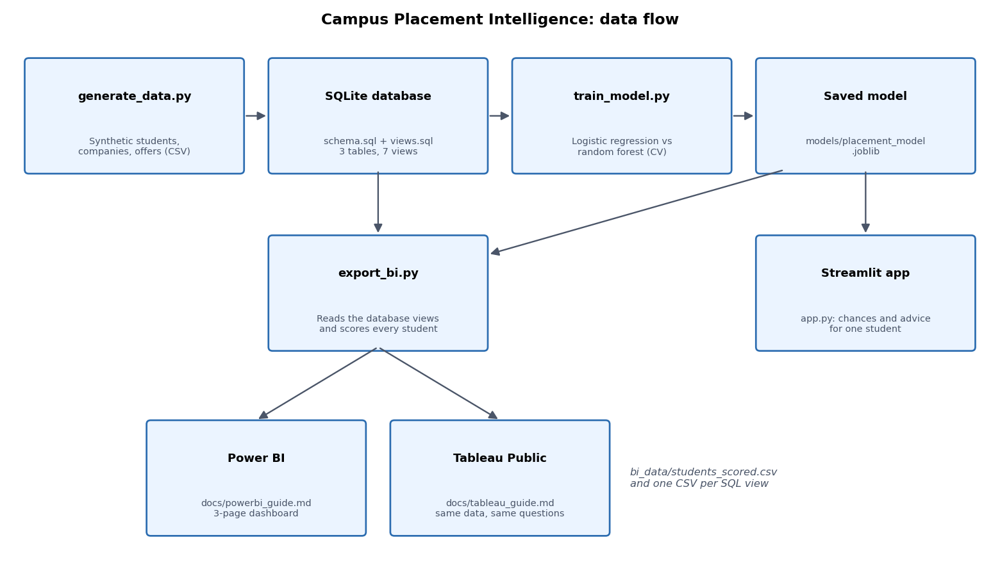
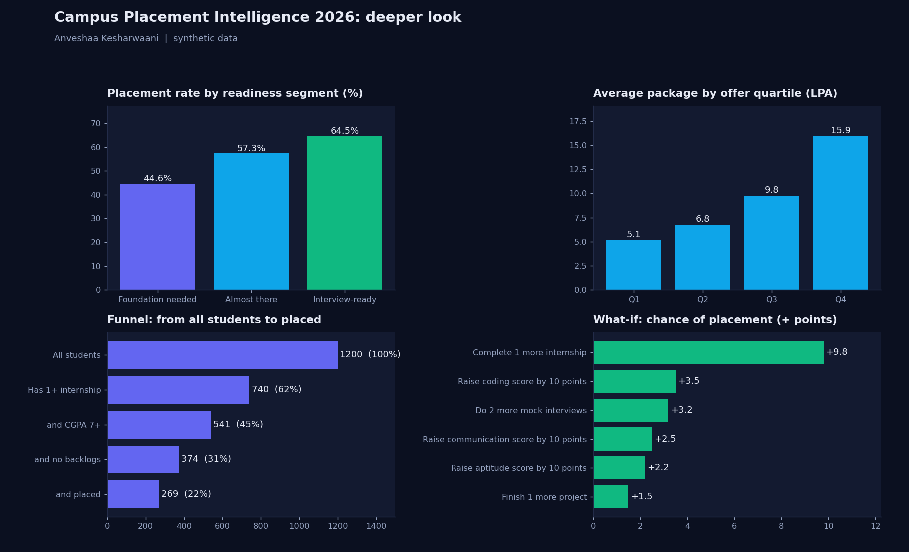
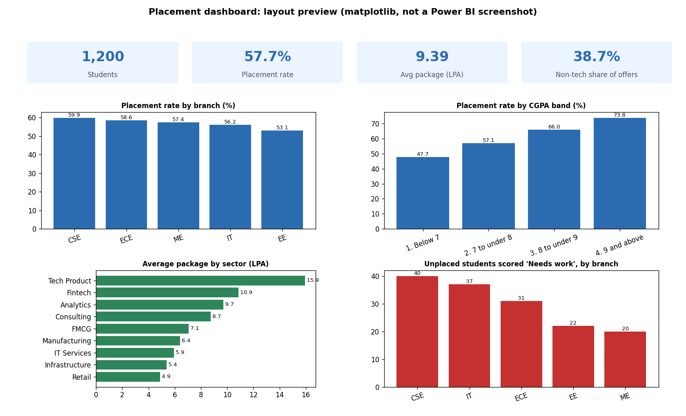
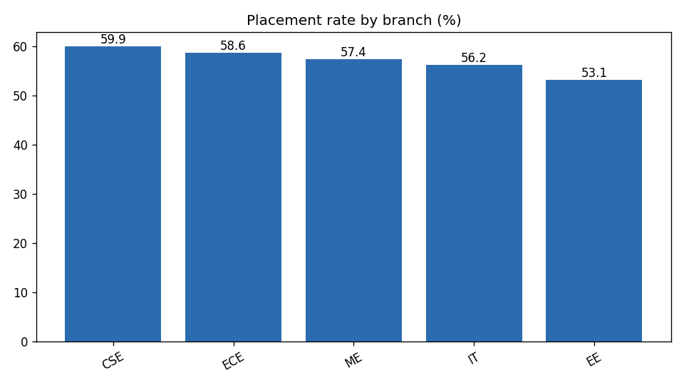
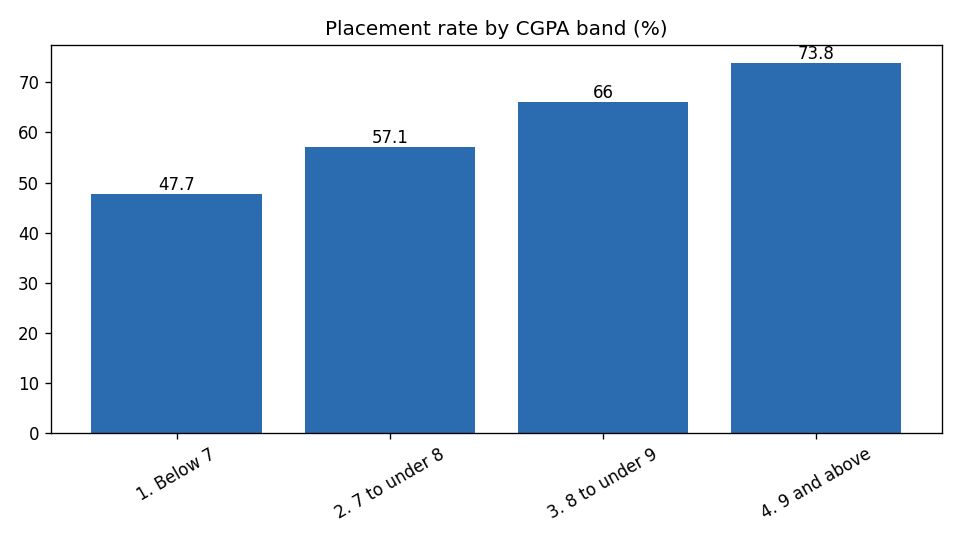
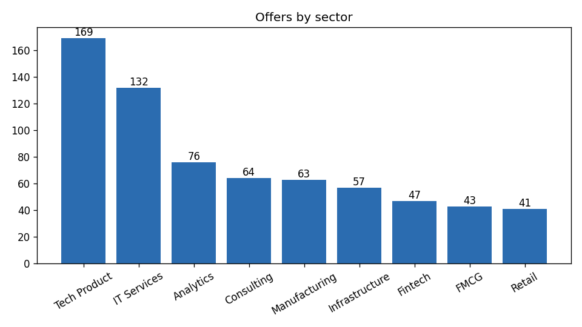
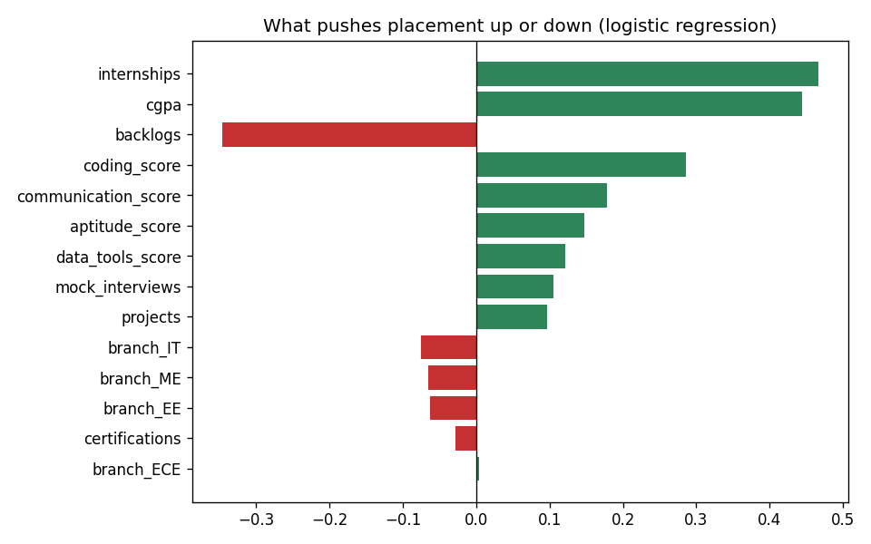

# Campus Placement Intelligence 2026 (v2)

**Author:** Anveshaa Kesharwaani

A placement analytics project for a college placement cell. It uses **SQL** for the data layer, **Python** to build a placement-chance model, and **Power BI** and **Tableau** for dashboards.

> **All data is synthetic (fictional).** `src/generate_data.py` creates it with a made-up rule. The numbers show how the method works. They are not facts about any real college or student.



## What it does

- Stores students, companies, and offers in a SQL database (SQLite) with 7 analysis views.
- Answers questions such as: Which branches place best? Does CGPA matter? How big is the non-tech opportunity?
- Compares two models for placement chance and explains which factors push it up or down.
- Gives every student an AI placement probability (scored out-of-fold, so it is not flattered by training data) and one piece of advice on what to work on first.
- Exports clean CSV files that load straight into Power BI and Tableau.
- Includes a Streamlit app that gives one student an estimate and advice on what to improve first.
- **New in v2:** a what-if simulator ("what if my coding score rises 10 points?"), a greedy 3-step improvement plan, 5 more SQL views with window functions, a standalone interactive HTML dashboard, and a GitHub Actions test workflow. See [CHANGELOG.md](CHANGELOG.md).

## Tools used

| Tool | Used for |
|---|---|
| SQL (SQLite) | Tables, constraints, and 7 analysis views in `sql/` |
| Python (pandas, scikit-learn) | Data generation, model training, CSV export |
| Power BI | 3-page dashboard (guide in `docs/powerbi_guide.md`) |
| Tableau Public | Same dashboard (guide in `docs/tableau_guide.md`) |
| Streamlit | Web app: estimate, advice, what-if simulator, 3-step plan |
| HTML + JavaScript | `dashboard/index.html`, an offline interactive dashboard with filters |
| GitHub Actions | Runs the pipeline and tests on every push |

## Interactive dashboard (open in any browser)

After `python run_pipeline.py`, double-click `dashboard/index.html`. It needs no server and no internet. Filters for branch, CGPA band and company type update every card and chart. Its totals match the SQL views (57.7% placement rate, 38.7% non-tech offers).

## v2 insights



**What-if example (median-profile student, synthetic data).** Best three steps in order: complete 1 more internship (+9.8 points, to 76%), raise coding score by 10 (+2.8), do 2 more mock interviews (+2.4), reaching about 81%. These show how the *model* reacts. They do not prove that these steps cause an offer.

## Dashboard layout preview

This picture is drawn with matplotlib from `bi_data/students_scored.csv`. It shows the intended layout. It is not a Power BI screenshot.



## Charts from the SQL views

| Placement rate by branch | Placement rate by CGPA band |
|---|---|
|  |  |

| Offers by sector | Factors behind placement |
|---|---|
|  |  |

## Quick start

Requires Python 3.10 or newer. Run every command from the project folder.

```bash
python -m venv .venv
# Windows:        .venv\Scripts\activate
# macOS / Linux:  source .venv/bin/activate

pip install -r requirements.txt
python run_pipeline.py          # data, database, model, charts, summary, BI files, pictures
python -m pytest -q             # 11 tests
streamlit run app.py            # web app
```

**Only want the dashboards?** You do not need Python. The finished CSV files are already in `bi_data/`. Open `bi_data/students_scored.csv` in Power BI or Tableau and follow the guides in `docs/`.

## Project structure

```text
campus-placement-intelligence/
├── README.md
├── LICENSE
├── requirements.txt
├── run_pipeline.py            runs every step in order
├── app.py                     Streamlit web app (advice, what-if, plan)
├── CHANGELOG.md
├── .github/workflows/ci.yml   runs pipeline and tests on GitHub
├── dashboard/index.html       interactive offline dashboard
├── sql/
│   ├── schema.sql             3 tables with CHECK constraints
│   ├── views.sql              7 analysis views
│   ├── advanced_views.sql     5 v2 views: RANK, NTILE, LAG, running totals
│   └── analysis_queries.sql   8 more queries: windows, CTE, NTILE, data check
├── src/
│   ├── generate_data.py       synthetic students, companies, offers
│   ├── build_database.py      CSV to SQLite
│   ├── features.py            feature list shared by training and the app
│   ├── train_model.py         trains and compares two models
│   ├── advisor.py             rule-based advice for a student
│   ├── whatif.py              what-if simulator and 3-step plan
│   ├── html_dashboard.py      builds dashboard/index.html
│   ├── insights_image.py      reports/insights_2026.png
│   ├── charts.py              PNG charts from the SQL views
│   ├── report.py              reports/summary.md
│   ├── export_bi.py           CSV files for Power BI and Tableau
│   └── images.py              architecture diagram and dashboard preview
├── tests/test_pipeline.py     11 automated tests
├── data/                      generated CSV files and placement.db
├── models/                    saved model
├── reports/                   charts, metrics, summary
├── bi_data/                   CSV files for Power BI and Tableau
└── docs/
    ├── powerbi_guide.md       step-by-step dashboard build
    ├── tableau_guide.md       same dashboard in Tableau
    ├── sql_views_explained.md every view explained, plus practice queries
    ├── how_to_explain_this_project.md
    └── screenshots/           put your dashboard screenshots here
```

## SQL layer

| View | Question |
|---|---|
| `vw_branch_summary` | Which branch places best, and what does it pay? |
| `vw_cgpa_band` | Does a higher CGPA help? |
| `vw_backlog_impact` | How much do backlogs hurt? |
| `vw_skill_gap` | Where do placed and unplaced students differ? |
| `vw_sector_offers` | Which sectors give offers, and at what pay? |
| `vw_non_tech_share` | How large is the non-tech opportunity? |
| `vw_student_flat` | One row per student with offer details, for the dashboards |

Every view is explained in [docs/sql_views_explained.md](docs/sql_views_explained.md), with four practice queries. `sql/analysis_queries.sql` adds 8 more using window functions, a CTE, and a data-quality check.

## Results (synthetic data, seed 2026)

- 1,200 students, 692 offers, placement rate 57.7%.
- Non-tech companies gave 38.7% of offers at an average of 6.61 LPA. Tech companies averaged 11.15 LPA.
- Internships, CGPA, and coding score push placement up. Backlogs push it down.
- Placement rate by branch ranges only from 53.1% (EE) to 59.9% (CSE). With 128 EE students, that gap is small enough to be noise.

**Model.** Logistic regression is used. Random forest scored 0.695 cross-validated ROC-AUC against 0.691, which is too small a gap to justify a less explainable model. On the test set, logistic regression reached ROC-AUC 0.678 and accuracy 0.66. A model that always predicted "placed" would be 57.7% accurate, so 0.66 is better than that baseline, but only modestly. Treat any single estimate as a rough guide.

**Does the AI score work?** Out-of-fold scores sort students sensibly. Actual placement was 31.2% in the "Needs work" band, 56.9% in "Moderate", and 76.8% in "Strong".

Full numbers: `reports/summary.md` and `reports/metrics.json`.

## Dashboards

Build the Power BI dashboard with [docs/powerbi_guide.md](docs/powerbi_guide.md) and the Tableau version with [docs/tableau_guide.md](docs/tableau_guide.md). Each guide lists the exact measures and the numbers your cards should show (for example 57.7% placement rate and 9.39 LPA average package), so you can check your work against the SQL.

## Method choices and limits

- **No personal attributes.** Name, gender, caste, religion, and address are neither generated nor modelled. If you use real data, test whether the model treats groups differently first.
- **Estimates, not guarantees.** The probability reflects patterns in past records, not what will happen to one student.
- **Correlation, not causation.** The advisor compares a student with placed students. Closing a gap does not guarantee an offer.
- **Small factors are noise.** Coefficients near zero, such as certifications here, should not be interpreted.
- **Test split used once.** Models are compared with cross-validation on the training split. The test split is reported at the end.

## Using real data

Keep these columns in `data/students.csv`: `student_id, branch, cgpa, backlogs, internships, projects, certifications, coding_score, aptitude_score, communication_score, mock_interviews, data_tools_score, placed` (`placed` is 0 or 1). Remove names and contact details first. Every placed student needs one row in `offers.csv`. Then run `python run_pipeline.py --use-existing-data`. This skips data generation and keeps your CSV files.

## Acknowledgements

The code in this repository was written with help from Claude (Anthropic). The data is synthetic, and all company names are fictional.

## License

MIT License. See [LICENSE](LICENSE). Copyright (c) 2026 Anveshaa Kesharwaani.
